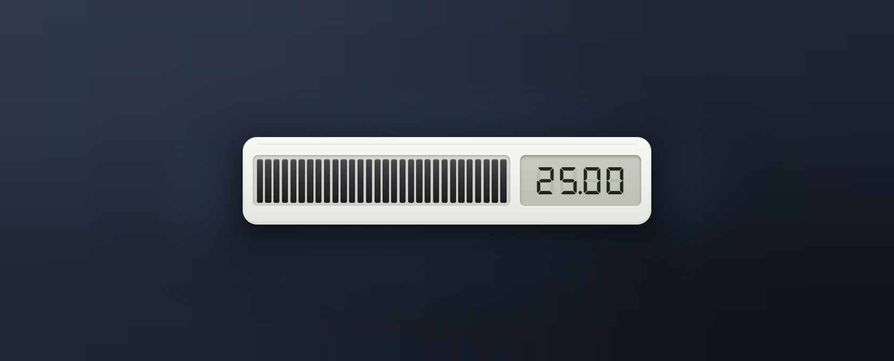
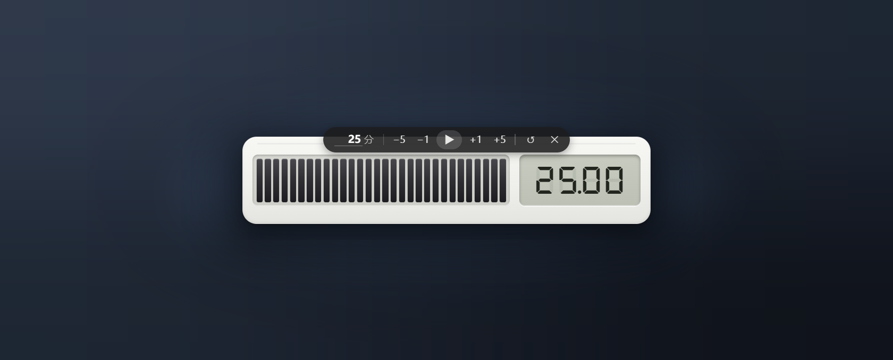
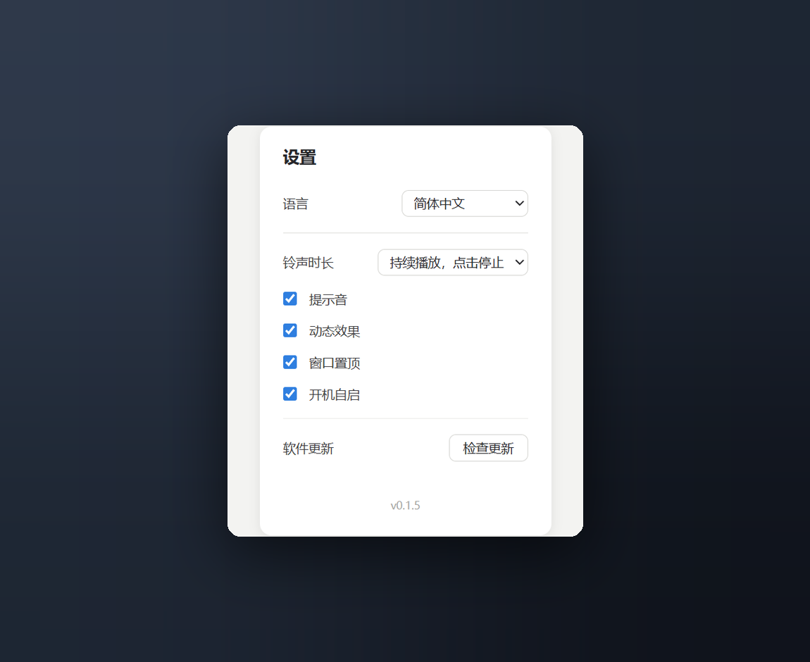

# 桌面置顶计时器

[English](README.md)

仿实体视觉计时器的 Windows 桌面小部件：白色圆角机身浮在桌面上，左侧 30 段刻度条随时间熄灭，右侧液晶七段码屏显示 `分.秒`。支持中文 / English / 日本語 / Русский。

基于 [MyGo](https://github.com/egoist/mygo)（Go + 系统 WebView2），纯 Go 无 cgo，release 构建产物为单个 ~9MB 的 `timer.exe`，前端为内嵌的纯静态 HTML/CSS/JS。





## 功能分层

- **顶栏（悬停浮现，高频操作）**：模式切换（∞/1×）、自定义时长输入、±1/±5 分钟、开始/暂停、跳过本段（循环模式）、归零、隐藏到托盘
- **托盘（低频开关 + 入口）**：显示/隐藏、窗口置顶、提示音、开机自启、设置…、退出
- **设置窗口**（托盘「设置…」打开）：左侧导航分两栏——**通用设置**（语言、到点铃声时长、提示音、动态效果、窗口置顶、开机自启、软件更新）与**时间表**（计时模式、工作/休息时长、每日时间表编辑），软件更新支持一键检查 → 自动下载换文件重启



### 循环作息模式（∞）

像上学时的时间表：在设置的「时间表」页里自己排一天的时段——**循环**段内按 工作/休息 交替（默认 45 分 + 10 分，可改），**休息**段是整段纯休息（午休、午睡都配这种）。铃按钟点响，不按「你几点点开始」：

- 可选**长休息**：循环段内每工作 N 轮，随后的休息变为长休息（如每 4 轮休 15 分，0 = 不启用）

- 任何时刻点开始都直接加入进行中的时段（09:20 开始 → 直接进 09:00 那个块剩的 25 分钟）；中途重启软件再点开始，自动接上今天课表的当前位置
- 时段之间的空档按「休息」倒计时到下一段开始；过了最后一条时段再点开始 = 「今日完成」收工铃
- 休息相位刻度条亮绿色；液晶屏上方小字显示 工作/休息/今日完成；`»` 或 S 键跳过当前相位（下一段仍按原计划钟点结束）
- 一条时段都不配时退化为无限 工作/休息 循环，直到手动归零
- 时间表行带拖动手柄（⋮⋮），保持你排列的顺序；重叠时段按先开始者优先
- 自动切换（默认开）：段末单响一声自动进下一段；关掉后每段结束按铃声设置响，点击确认才继续
- 时间表存放在 `config.json`，带结构版本号和迁移链，软件升级不丢数据

三处共享同一份状态（Go 为唯一事实源 + `state` 事件广播）：托盘勾选、设置窗口、界面文案任一处变化，其余即时同步。界面语言支持中文 / English / 日本語 / Русский，托盘菜单、窗口标题、设置页、顶栏提示文案全部跟随。

## 其他

- **无边框透明窗口**，圆角机身 + 柔和投影，默认置顶，不占任务栏
- 关闭/Esc 隐藏到托盘；**开机自启**写当前用户 Run 注册表项（勾选状态以系统为准）
- **位置与偏好记忆**：窗口位置（MyGo StateKey）和时长/声音/置顶/语言/铃声时长（`userData/config.json`）跨启动恢复
- **软件更新**：设置窗口一键检查 GitHub Releases，发现新版本自动下载、换文件并重启；旧文件自动清理
- 单实例：重复启动把计时器叫到前台
- 计时基于时间戳差值，系统休眠或节流后仍准确；归零时数字快闪 + 上行铃音循环响，**点击计时器（或空格/R）即停**；时长默认「持续响」，可在设置里改为响一遍 / 10 秒 / 30 秒；最后 10 秒末段闪红
- **动态效果**：开始计时机身钟摆式轻晃、到点随铃音铃声式抖动，设置里可整体关闭

## 操作

| 操作 | 效果 |
| --- | --- |
| 拖动机身 | 移动窗口 |
| 单击刻度条 / 液晶屏 | 开始 / 暂停（循环模式：确认下一段 / 关掉「今日完成」） |
| 双击液晶屏 | 归零 |
| 滚轮（刻度条上） | ±1 分钟（单次模式） |
| 顶栏输入框 | 自定义时长（1–99 分钟），回车确认（单次模式） |
| 空格 / R | 开始暂停 / 归零 |
| S | 跳过当前相位（循环模式） |
| ↑ / ↓（Shift） | ±1 分钟（±5）（单次模式） |
| Esc | 隐藏到托盘 |

## 开发

需要 Go 1.27+ 和 Windows 10/11（自带 WebView2 Runtime）。

```bash
# 开发：保留控制台窗口方便看日志
go build -ldflags "-X github.com/egoist/mygo.production=1" -o timer.exe .
./timer.exe

# 发布：-H windowsgui 不弹控制台窗口，-s -w 去调试信息减小体积
go build -trimpath -ldflags "-s -w -H windowsgui -X github.com/egoist/mygo.production=1" -o timer.exe .
```

版本号在 `version.go`；推 `v*` 标签会触发 GitHub Actions 自动按标签注入版本号、构建、打包 zip 并创建 Release（`.github/workflows/release.yml`），无需手动去网页上传。

前端在 `frontend/`（纯静态，无构建步骤）：`i18n.js` 是主窗口与设置页共用的多语言字典，加语言时在 Go 的 `i18n()`（托盘/标题）和 `i18n.js`（页面文案）各加一份即可。直接用浏览器打开 `frontend/index.html` 可预览样式（自动降级：localStorage 代替 Go 绑定）。

### 结构

```
main.go            MyGo 窗口（无边框/透明/置顶）、托盘、设置窗口、state 事件、单实例
prefs.go           偏好持久化：config.json 读写、结构版本迁移链、校验钳位
prefs_test.go      持久化层测试（旧格式迁移、坏值钳位、课表校验）
version.go         应用版本号（CI 打 tag 时自动重写注入）
frontend/
  index.html       计时器主界面
  settings.html    设置窗口（通用设置 / 时间表 两栏导航）
  i18n.js          多语言字典（中文/英/日/俄）
  style.css        机身/刻度条/液晶屏/控制条样式
  settings.css     设置窗口样式
  timer.js         计时逻辑与交互、课表引擎、状态同步
  fonts/           DSEG7 Classic 字体（MIT）
assets/tray.png    托盘图标
```

### 调试参数（对运行中的实例）

```bash
./timer.exe --settings                     # 打开设置窗口
./timer.exe --update                       # 检查并应用更新
./timer.exe --controls --shot out.png      # 顶栏常显并截取主窗口页面
./timer.exe --shot-settings out.png        # 截取设置窗口页面
./timer.exe --set sound=off                # 外部驱动开关：sound|pin|autostart=on|off
./timer.exe --set lang=en                  # 切换语言：zh-CN|en|ja|ru
./timer.exe --set alarm=loop               # 到点铃声：once|10|30|loop
./timer.exe --set mode=cycle               # 计时模式：countdown|cycle
./timer.exe --set cyclework=1              # 循环工作时长（分钟，cyclerest 同理）
./timer.exe --set schedule=09:00-12:00:cycle,12:00-13:30:break   # 注入课表（测试用）
```

环境变量 `TIMER_RELEASE_API` 可覆盖更新查询地址（默认 `https://api.github.com/repos/ctzcs/Timer/releases/latest`；API 被限流/拦截时自动回退到 `releases/latest` 页面重定向解析）。
